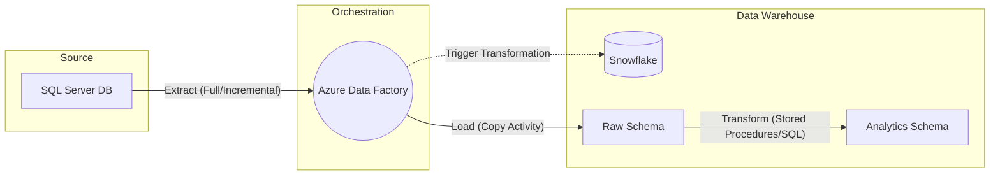

# Retail Data Pipeline: SQL Server to Snowflake via Azure Data Factory

> [!IMPORTANT]
> This repository contains a production-grade data pipeline architecture designed to seamlessly extract, load, and transform (ELT) retail operations data. The pipeline extracts data from an on-premises or cloud SQL Server instance, orchestrates the movement using Azure Data Factory (ADF), and executes complex transformations within Snowflake to serve analytical workloads.


## 📌 Architecture Overview

This project implements a modern data stack pattern focusing on robust orchestration, scalability, and modular transformation logic.



## 🛠️ Technology Stack

- **Data Source:** Microsoft SQL Server
- **Orchestration:** Azure Data Factory (ADF)
- **Data Warehouse:** Snowflake
- **Scripting & Automation:** Python 3.x, Bash, Azure CLI, ARM Templates
- **Infrastructure as Code (IaC):** Azure Resource Manager (ARM)

## 📁 Repository Structure

```text
.
├── adf/                    # Azure Data Factory assets
│   ├── arm_template.json   # Infrastructure as Code for ADF pipelines and linked services
│   └── deploy.sh           # Deployment script using Azure CLI
├── python/                 # Data generation and seeding utilities
│   └── seed_data.py        # Script to populate SQL Server with realistic retail dummy data
├── snowflake/              # Snowflake DDL and DML scripts
│   ├── 01_setup.sql        # Warehouse, Database, Schema, and Role configurations
│   └── 02_transformations.sql # ELT transformation logic (Views, Tasks, Procedures)
├── sql_server/             # Source database configurations
│   └── 01_create_tables.sql # DDL for the source retail data model
└── docs/                   # Additional documentation
```

## ⚙️ Setup & Deployment Guide

> [!CAUTION]
> Ensure you have the necessary permissions (Contributor/Owner) in Azure and AccountAdmin/SysAdmin privileges in Snowflake before proceeding with the deployment.

### 1. Source Database Initialization (SQL Server)
Execute the DDL script to create the required schema in your SQL Server instance:
```bash
# Execute via sqlcmd or your preferred SQL client
sqlcmd -S <server_name> -d <database_name> -U <username> -P <password> -i sql_server/01_create_tables.sql
```

Populate the database with synthetic retail data:
```bash
pip install -r requirements.txt # (if applicable)
python python/seed_data.py
```

### 2. Data Warehouse Configuration (Snowflake)
Run the setup scripts in your Snowflake environment (e.g., via SnowSQL or the Snowflake Web UI) to provision the necessary warehouses, databases, and schemas.

```sql
-- Execute 01_setup.sql first
-- Execute 02_transformations.sql to deploy business logic
```

### 3. Orchestration Deployment (Azure Data Factory)
Deploy the ADF resources using the provided bash script and ARM template. This will provision the Data Factory, linked services, datasets, and pipelines.

```bash
cd adf/
chmod +x deploy.sh
./deploy.sh -g <ResourceGroupName> -f <DataFactoryName> -l <Location>
```

> [!NOTE]
> Post-deployment, navigate to the ADF Studio to securely configure the connection strings for SQL Server and Snowflake Linked Services, as these are omitted from the ARM template for security best practices.

## 📈 Data Model & Transformations

The pipeline implements a Medallion-like architecture within Snowflake:
1.  **Raw Layer:** Ingests raw data directly from SQL Server without structural changes.
2.  **Staging/Integration Layer:** Normalizes data types, handles deduplication, and establishes relationships.
3.  **Analytics/Presentation Layer:** Materializes denormalized views and aggregated tables optimized for BI tools (e.g., PowerBI, Tableau).

## 🔒 Security Best Practices

- **Secrets Management:** All sensitive credentials must be stored in Azure Key Vault and referenced within ADF.
- **Network Isolation:** Consider using Self-Hosted Integration Runtimes (SHIR) for on-premises SQL Server and Private Link for secure Azure-to-Snowflake communication.
- **Role-Based Access Control (RBAC):** Strict adherence to least-privilege principles within both Azure (IAM) and Snowflake (Roles).

## 💡 Future Enhancements

-   [ ] Implement CI/CD via GitHub Actions / Azure DevOps.
-   [ ] Introduce dbt (data build tool) for advanced transformation lifecycle management.
-   [ ] Integrate Data Quality testing frameworks (e.g., Great Expectations).
-   [ ] Implement Change Data Capture (CDC) for near real-time ingestion.
